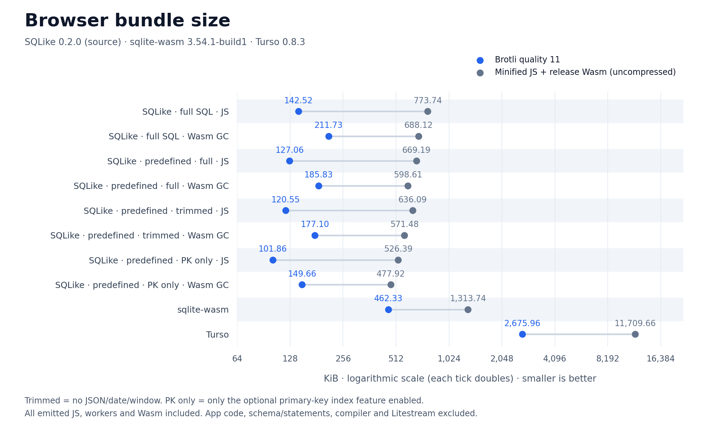
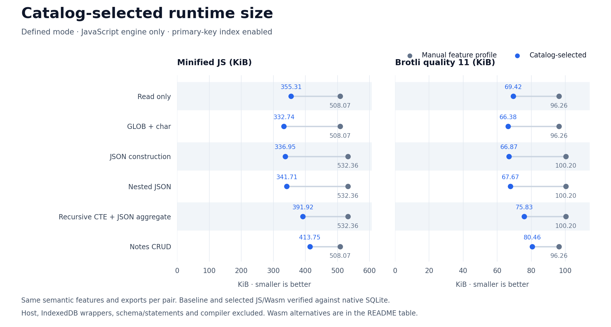
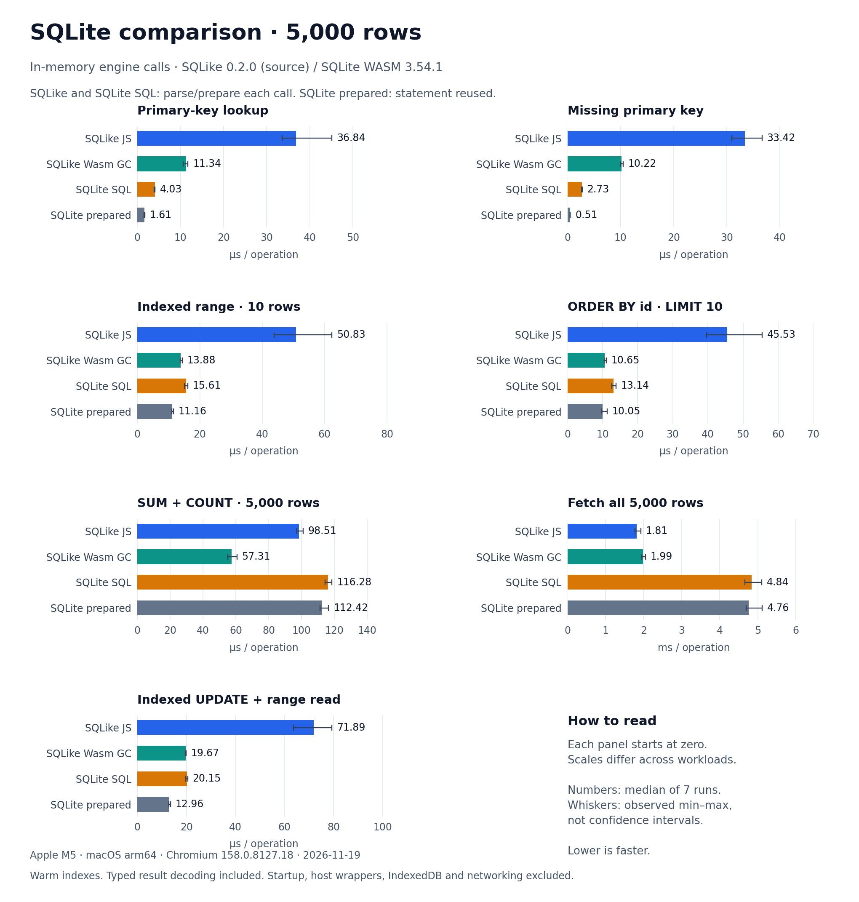
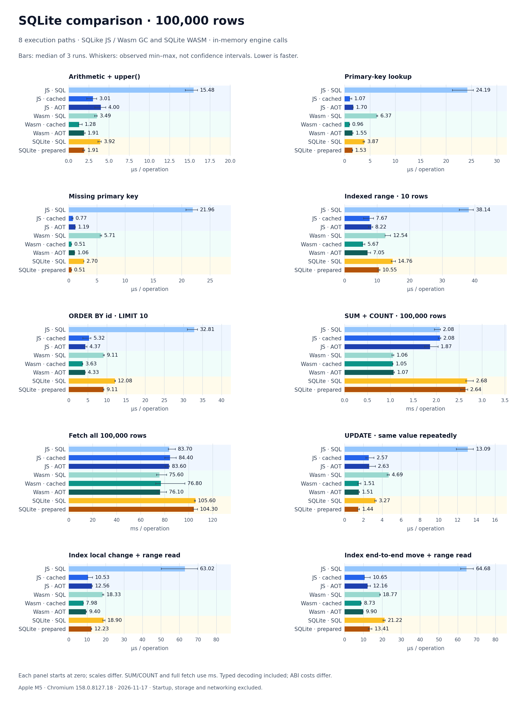

# SQLike

[English](README.md) | **日本語**

このREADMEは0.2.0の内容です。[移行・リリースノート（英語）](docs/releases/v0.2.0.md)。

ブラウザやNode.jsでSQLを実行できる、MoonBit製のSQLiteサブセットです。インメモリDBとして使うほか、あらかじめ定義したSQLをIndexedDBへ保存しながら実行できます。同期には独立した `@mizchi/litestream` を組み合わせます。

## できること

| 用途 | 提供する機能 |
| --- | --- |
| アプリ内のSQLデータベース | CRUD、JOIN、集約、RETURNING、transaction、index、FK、基本trigger |
| オフラインでの保存・再開 | 固定schemaとnamed statementを使うIndexedDB保存。接続やページを開き直して再開 |
| 配信する機能の選択 | SQLパーサを含まない実行、独自生成runtimeの注入、compiler・SQLite出力・Drizzleの別entry |
| Drizzleとの連携 | 型付きクエリ、RETURNING、migration、入れ子transaction |
| サーバーとの同期 | SQL / SQLite Session差分、再送、重複排除、利用側で記述する適用・競合policy |
| SQLite・LTXとの受け渡し | SQLite画像の書き出し、LTX v3の生成・適用 |

## インストール

JavaScript / TypeScript向けに、[SQLike](https://www.npmjs.com/package/@mizchi/sqlike)と[Litestream](https://www.npmjs.com/package/@mizchi/litestream)をnpmで公開しています。ESM、Node.js 24以上と現行ブラウザ向けです。実行にMoonBitコンパイラは不要です。

```sh
pnpm add @mizchi/sqlike
# 同期・LTXも使う場合
pnpm add @mizchi/litestream
```

[GitHub Releases](https://github.com/mizchi/sqlike/releases)にも配布用アーカイブを用意しています。

0.2.0では既定entryをCRUD・JOIN・index・FK・STRICTのbaselineに分け、JSON・CTE・trigger・window等を含む実装済みSQL機能は`@mizchi/sqlike/full`へ移します。[`@mizchi/sqlike/aot`](docs/native-aot.md)はパーサなしのprepared named statementをJS / Wasm GCで実行し、`/aot/native`はJS専用の高速な値受け渡しを提供します。[MoonBitソース出力・選択ビルド・依存検証](docs/build-targets.md)も利用できます。複数の既成engineを併用するとruntimeが重複するため、アプリでは一つ選びます。

baselineでは、整数・文字列用の`format / printf`と単一MIN / MAXの一意な代表行も使えます。曖昧な集約出力、SQLiteの版で結果が異なる空format、未対応の変換は明示的に拒否します。

任意選択の[増分ページ出力](docs/incremental-pager.md)では、rowidを保つ更新をSQLiteページへ反映し、IndexedDBでLTX outboxと原子的に保存できます。`sqlitePages`と`@mizchi/sqlike/pager`を明示指定し、構造変更には全量出力を使います。リポジトリの永続AOT adapterでは`checkpoint()`・論理状態の復元・送信再試行・ACK済みoutbox回収にも接続しています。差分checkpointに対応するproviderでは、論理compaction時に未変更の行chunkを再利用し、全DBのJSON化も避けます。

未確認LTXが上限（既定128件）に達すると、永続adapterはcheckpoint生成を保留し、SQLのローカル保存を継続します。再接続時は検証済みACKを先に回収してから、最新の変更をcheckpoint・送信します。[保留と同期の使い方](docs/incremental-pager.md#existing-durable-checkpoint-adapter)。

## バンドルサイズ

0.2.0ソースのエンジン単体です。host wrapper・catalogデータ・Litestreamは別です。

| エンジン | JS minified | Brotli |
| --- | ---: | ---: |
| tableなし・SELECTのみのAOT | 262.90 KiB | 53.51 KiB |
| Vite既定構成・SELECTのみのAOT | 281.95 KiB | 56.86 KiB |
| 実行専用CRUD AOT | 333.26 KiB | 66.16 KiB |
| 標準APIの最小CRUD AOT | 358.84 KiB | 69.74 KiB |
| Vite plugin既定構成のCRUD AOT | 364.08 KiB | 71.32 KiB |
| 主キー索引・optimizerありのCRUD AOT | 389.52 KiB | 74.95 KiB |
| Baseline | 565.36 KiB | 106.16 KiB |
| 全SQL実行機能のAOT | 665.25 KiB | 122.52 KiB |
| SQLパーサを含むFull | 769.08 KiB | 141.28 KiB |

2026-11-20（JST）、OXCでminifyし、Brotli quality 11で計測。1 KiB = 1,024 bytes。SELECTのみのcatalogはtableなしのbind付きSELECTです。CRUDのcatalogは1テーブルのINSERT・主キーSELECT・UPDATE・DELETEの4文です。最小SELECTと最小CRUDでは任意の主キー索引とoptimizerを無効にし、主キー制約は維持します。実行専用版は4 exportに絞り、文単位のatomic性を維持します。Vite構成は既定の索引・optimizerを有効にした実行専用APIです。標準APIのCRUD構成にはsnapshot・restore・clone・delta・prepared handleも残ります。全SQL実行機能のAOTはSQLite/LTX出力を省いています。

実行専用版は`apiCapabilities: []`を指定し、生成runtimeを`@mizchi/sqlike/aot/core`の`openAotExecutor`へ注入します。[公開APIの選択方法](docs/build-targets.md#aotの公開apiを選ぶ)。実行専用CRUDのJSエンジンとhostの合計は**335.00 KiB / Brotli 66.85 KiB**で、catalogデータは別です。

[最小JSの比較](measurements/aot-minimum-current.json) · [CRUDの測定値](measurements/sqlike-crud-size-current.json) · [entry別の測定値](measurements/sqlike-entrypoints-current.json) · [Wasmサイズ・ビルド設定](docs/internal/sqlike-build-contract.md#エンジン単体のサイズ)。`just explore-aot-size`、`just measure-crud-size`、`just measure-entrypoints`で再現できます。

### browser bundle比較

ブラウザ向けの公開entryをOxcでminifyした配布物の合計です。JSローダー・分割chunk・生成されるWorker・Wasmを含み、Brotliは各ファイルをquality 11で圧縮して合算しています。1 KiB = 1,024 bytes。Wasmはrelease出力を使用します。

SQLikeは0.2.0ソースで計測しています。通常SQLはJS / Wasmともfullを使い、JSON・CTE・windowの実行を確認しています。[段階的な互換機能の導入](docs/internal/staged-sqlite-compatibility.md)に追加内容とサイズ差を記録します。

[](docs/images/bundle-size.png)

[SVG版](docs/images/bundle-size.svg)

横軸は対数目盛で、1目盛ごとにサイズが2倍になります。点に記載した数値はKiBです。

<details>
<summary>数値を表で見る（10構成）</summary>

<!-- bundle-size:start -->
| ビルド | minified・未圧縮 | Brotli |
| --- | ---: | ---: |
| SQLike 0.2.0 (source) / 通常SQL・full / JS | 773.74 KiB | 142.52 KiB |
| SQLike 0.2.0 (source) / 通常SQL・full / Wasm GC | 688.12 KiB | 211.73 KiB |
| SQLike 0.2.0 (source) / 事前定義・全実行機能 / JS | 669.19 KiB | 127.06 KiB |
| SQLike 0.2.0 (source) / 事前定義・全実行機能 / Wasm GC | 598.61 KiB | 185.83 KiB |
| SQLike 0.2.0 (source) / 事前定義・JSON・日時・windowなし / JS | 636.09 KiB | 120.55 KiB |
| SQLike 0.2.0 (source) / 事前定義・JSON・日時・windowなし / Wasm GC | 571.48 KiB | 177.10 KiB |
| SQLike 0.2.0 (source) / 事前定義・主キー索引のみ / JS | 526.39 KiB | 101.86 KiB |
| SQLike 0.2.0 (source) / 事前定義・主キー索引のみ / Wasm GC | 477.92 KiB | 149.66 KiB |
| sqlite-wasm 3.54.1-build1 | 1313.74 KiB | 462.33 KiB |
| Turso 0.8.3 | 11709.66 KiB | 2675.96 KiB |
<!-- bundle-size:end -->

</details>

事前定義版はSQLパーサを含みません。機能選択版とWasm GC版は、同じ公開host APIを使うカスタムビルドです。「主キー索引のみ」は任意機能の選択で、CRUD・集約・CTE・secondary indexはコアに残ります。SQLikeはSQLiteサブセットのため、他のエンジンと機能範囲は異なります。

表は手動の機能プロファイルです。[catalog別のビルド](docs/catalog-build.md)では、未使用の関数群・文・JOIN・CTE・複合SELECTの実装も除去できます。そのランタイムのサイズを下に示します。

アプリのHTML・コード、事前ビルドしたschema / statement、ビルド時compiler、任意のSQLite exporter、Litestreamは含みません。任意Workerも含む配布assetの合計であり、初回起動時の最小ダウンロード量とは異なります。各行の計測済みminified bundleはChromiumでDBを開いて書込・読取まで確認しています。

比較対象は[@sqlite.org/sqlite-wasm](https://www.npmjs.com/package/@sqlite.org/sqlite-wasm)と[@tursodatabase/database-wasm](https://www.npmjs.com/package/@tursodatabase/database-wasm)です。

[計測条件・ファイル別サイズ](measurements/bundle-size-current.json)。再計測は`just bundle-size`で行えます。

### catalogから絞ったランタイム

この節は0.2.0ソースのcatalogエンジン単体です。上のbrowser配布物の合計とは範囲が異なります。

schemaとクエリが固定されている場合、AOTと事前定義版ではcatalogに必要な実装だけを残せます。AOTはJSONのプログラム定義、`defined`はバイナリ定義を読み込みます。各比較で、意味上の機能・公開exports・主キー索引の設定を揃えています。

[](docs/images/catalog-runtime-size.png)

[SVG版](docs/images/catalog-runtime-size.svg)

下表は**エンジンのファイル単体**で、host・IndexedDB wrapper・schema / statement・compilerを含みません。JSとWasmは別々の実行対象で、Wasmの値にはJSローダーを含みません。上の配信全体の表ではhostとローダーも含めています。すべてのcatalogをJS / Wasmの両方でnative SQLiteと照合済みです。

<details>
<summary>ランタイムの数値を見る（6 catalog × 2モード）</summary>

<!-- catalog-runtime-size:start -->
| Catalog / モード | minified JS | JS Brotli | release Wasm | Wasm Brotli |
| --- | ---: | ---: | ---: | ---: |
| 読取専用 / AOT | 361.14 KiB | 69.88 KiB | 327.07 KiB | 104.12 KiB |
| 読取専用 / defined | 355.31 KiB | 69.42 KiB | 318.56 KiB | 102.40 KiB |
| GLOB + char / AOT | 338.92 KiB | 66.73 KiB | 308.25 KiB | 98.62 KiB |
| GLOB + char / defined | 332.74 KiB | 66.38 KiB | 299.75 KiB | 96.88 KiB |
| JSON生成 / AOT | 343.13 KiB | 67.51 KiB | 311.05 KiB | 99.35 KiB |
| JSON生成 / defined | 336.95 KiB | 66.87 KiB | 302.31 KiB | 97.80 KiB |
| 入れ子JSON / AOT | 347.87 KiB | 68.18 KiB | 314.86 KiB | 100.55 KiB |
| 入れ子JSON / defined | 341.71 KiB | 67.67 KiB | 306.38 KiB | 98.70 KiB |
| 再帰CTE＋JSON集約 / AOT | 397.89 KiB | 76.11 KiB | 360.78 KiB | 113.39 KiB |
| 再帰CTE＋JSON集約 / defined | 391.92 KiB | 75.83 KiB | 352.15 KiB | 111.75 KiB |
| Notes CRUD / AOT | 422.78 KiB | 80.75 KiB | 381.22 KiB | 120.25 KiB |
| Notes CRUD / defined | 413.75 KiB | 80.46 KiB | 369.08 KiB | 118.21 KiB |
<!-- catalog-runtime-size:end -->

</details>

catalogは主キー検索、GLOB / char、JSON生成、入れ子JSON、再帰CTE＋JSON集約、メモのCRUDを対象にしています。残る機能はcatalogによって異なります。単純なJSON生成だけなら、SQL JSONパーサ・パス解析・編集・patch・集約も除去します。

[catalogの計測結果](measurements/catalog-profiles-current.json) · [ビルド方法・制限](docs/catalog-build.md)。再計測は`just catalog-profiles`、図表の更新は`just readme-charts`で行えます。

## SQLiteとの速度比較

以下の汎用workloadは0.2.0ソースで計測しています。[IN SELECT](docs/internal/in-select-performance.md)と[UPDATE FROM](docs/internal/update-from.md)は、10万行を含む新しい計測を別に記録しています。

5,000行のテーブルでの**μs/操作**（小さいほど高速）、ウォームアップ後7サンプルの中央値です。通常SQLは毎回SQLをパース・prepareし、prepared列はSQLiteのstatementを再利用します。

[](docs/images/sqlite-benchmark.png)

[SVG版](docs/images/sqlite-benchmark.svg)

各グラフの軸はゼロ始まりですが、処理ごとに目盛幅が異なります。棒は中央値、ひげは7サンプルの最小〜最大です。全件取得のみ単位をmsにしています。画像をクリックすると原寸のPNGを開けます。

<details>
<summary>数値を表で見る（7処理・4経路、単位はすべてμs）</summary>

<!-- sqlite-benchmark:start -->
| 処理 | SQLike JS・通常SQL | SQLike Wasm GC・通常SQL | SQLite WASM・通常SQL | SQLite WASM・prepared |
| --- | ---: | ---: | ---: | ---: |
| 主キーで1行検索 | 36.84 | 11.34 | 4.03 | 1.61 |
| 存在しない主キーの検索 | 33.42 | 10.22 | 2.73 | 0.51 |
| 二次索引の範囲検索・10行 | 50.83 | 13.88 | 15.61 | 11.16 |
| ORDER BY id LIMIT 10 | 45.53 | 10.65 | 13.14 | 10.05 |
| sum(n), count(*) | 98.51 | 57.31 | 116.28 | 112.42 |
| 全5,000行取得 | 1,814.29 | 1,988.00 | 4,840.00 | 4,763.64 |
| 索引列の更新＋範囲10行取得 | 71.89 | 19.67 | 20.15 | 12.96 |
<!-- sqlite-benchmark:end -->

</details>

2026-11-20（JST）、Apple M5 / macOS arm64 / Chromium 158.0.8127.18で計測。SQLike 0.2.0ソースのMoonBit release出力（JSはminify前）と、SQLite WASM 3.54.1を同じページ内のインメモリDBで実行しています。

主キー・二次索引はウォーム状態です。更新の行は索引列の値を交互に変更し、その後の範囲検索までを含みます。結果の型変換と復号を含むエンジンAPIの比較で、host wrapper、起動・Wasmコンパイル、IndexedDB、通信は含みません。計測前後にnative SQLite由来の期待値と更新結果を照合しています。

通常SQLではパースとホスト境界のコストがあり、特に小さな検索でSQLiteとの差が残っています。実アプリの速度はクエリ・返却行数・永続化方式でも変わります。

[生データ・クエリ・全サンプル](measurements/sqlite-speed-current.json)。再計測は`just sqlite-bench --profiles=false`で行えます。

[10万行での比較](docs/internal/sqlite-large-benchmark.md)も掲載しています。SQLikeの任意statement cacheを含む8経路を、短いサンプル予算で計測します。

[現行ソースのIN・カーソル計測](docs/internal/in-list-performance.md)では、5千／10万行でoptimizerの有効・無効、本家SQLiteとの差、minified／Brotliの追加容量を比較しています。

<details>
<summary>10万行・8経路のグラフを見る</summary>

[](docs/images/sqlite-large-benchmark.png)

[SVG版](docs/images/sqlite-large-benchmark.svg)

各パネルの軸はゼロ始まりで、尺度は処理ごとに異なります。集約と全件取得はms、ほかはµs。ひげは観測した最小〜最大で、信頼区間ではありません。

</details>

## SQLを実行する

```ts
import { openDatabase } from '@mizchi/sqlike';

const db = openDatabase();
db.run('CREATE TABLE task(id INTEGER PRIMARY KEY,title TEXT NOT NULL)');

const rows = db.values(
  'INSERT INTO task VALUES(?,?) RETURNING id,title',
  [1n, '買い物メモ'],
);
// [[1n, '買い物メモ']]

const tasks = db.all('SELECT id,title FROM task ORDER BY id');
// [{ id: 1n, title: '買い物メモ' }]

db.transaction(() => {
  db.run('UPDATE task SET title=? WHERE id=?', ['更新したメモ', 1n]);
});
db.close();
```

`openDatabase()`はインメモリです。INTEGERは`bigint`、REALは`number`、BLOBは`Uint8Array`で扱います。`values()`は列位置順の配列、`all()`は列名をキーとするオブジェクトを返します。同名の結果列がある場合は`values()`を使います。

[SQLの対応範囲と値の扱い](docs/sql.md)

接続では、同じSQLを反復する接続に`openDatabase(undefined, { statementCache: { capacity: 32 } })`でcacheを有効にできます。接続ごとに保持する文とSQL本文の量を制限し、schema変更後は再準備します。[利用範囲と計測](docs/internal/dynamic-sql-prepare.md)。

## ViteでSQLファイルからAOTを生成する

`@mizchi/sqlike/vite` の `sqlikeAot({ include: 'src/client/**/*.sql', schemaFiles: 'src/schema.sql' })` をViteのpluginsへ追加します。ブラウザ側は `@mizchi/sqlike/aot` から `openDatabase` と `queries` をimportします。SQLの追加・変更・削除に応じて、必要な関数・機能だけを含むJS engineを生成します。

既定は `execute` / `close` の実行専用APIで、`api: 'connection'` ではprepared handle・snapshot・transactionを追加します。同じAOTビルドに通常SQLや別の既成engineを混在させるとエラーになります。ビルド用MoonBitソースとcompilerはブラウザentryへ入りません。[SQLの書き方・型生成・サイズレポート・cache](docs/vite-aot.md)を参照してください。

## IndexedDBへ保存する

ブラウザで使うschemaと問い合わせが決まっている場合は、ビルド時にDDLとnamed statementをコンパイルできます。実行側はバイナリ定義を読み込み、SQLパーサを配信せずに動きます。

0.1.2では、固定schemaのUPDATEと単純な主キーSELECTで準備済み実行計画を再利用します。bind値はクエリ構造と分離し、既存catalog・保存データの形式を維持します。

0.1.1では、[catalogから必要な機能を自動推定](docs/catalog-build.md)し、未使用の関数群・文・JOIN・CTE・複合SELECTの実装を除去できます。JSONの解析・生成・編集・patch・集約も別々に選択します。

```ts
import { DefinedDatabase } from '@mizchi/sqlike/defined';
import { catalog } from './catalog.generated.js';

const db = await DefinedDatabase.open('tasks', catalog);
await db.execute('add', [1n, 'オフラインで書いたメモ']);
const tasks = await db.prepare('list').all();
await db.close();
```

同じ名前とcatalogで開き直すと、保存したデータを読み込みます。保存先は差し替え可能です。保存データと異なるschemaを自動で読み替えることはありません。

[catalogの作成・永続化・SQLite出力](docs/prepared.md)

## Drizzleを使う

```sh
pnpm add drizzle-orm@0.45.4
```

```ts
import { openDatabase } from '@mizchi/sqlike';
import { drizzle } from '@mizchi/sqlike/drizzle';

const client = openDatabase();
const db = drizzle(client);
```

Drizzleは任意のentryです。通常のSQLや固定schemaの実行だけなら追加は不要です。

[テーブル定義・migration・transaction](docs/drizzle.md)

0.1.1では、[Drizzleクエリを事前定義catalogへ変換](docs/drizzle-prepared.md)し、ブラウザへORMとSQL parserを配信しない構成も使えます。

## 同期・LTXを使う

`@mizchi/litestream`はDBドライバーの契約を通じて同期します。SQLike・SQLite・Tursoとの構成例があり、Node、Cloudflare Durable Objects、P2Pリレーを正本や中継として使えます。利用できる同期方式は各driverの能力に依存します。

競合時には、利用側で適用・保留・拒否・置換を判断できます。LTXの生成・適用だけを使う場合は、`@mizchi/litestream/ltx`をimportします。

[同期の組み込み・競合処理・LTX](docs/sync.md)

## 利用上の制約

- ブラウザでの確認対象は現在Chromiumです。
- SQLite全機能互換ではありません。SQL・関数・PRAGMAには対応範囲があります。
- IndexedDB保存を使う場合も、クエリの実行中は行データをメモリに保持します。
- 固定schemaの実行では、実行時の任意DDLやschema変更の自動migrationは扱いません。
- 同期先の認証・認可、driverの選択、競合時の業務判断はアプリ側で用意します。

## MoonBitから使う

Mooncakesの2モジュールを単独で使えます。

```sh
moon add mizchi/sqlike@0.2.0
moon add mizchi/litestream@0.2.0
```

[SQLikeのAPI](packages/sqlike/README.md) / [LitestreamのAPI](packages/litestream/README.md)

MIT License。[リリース](https://github.com/mizchi/sqlike/releases) / [ユーザー向けガイド](docs/README.md) / [開発者向けドキュメント](docs/internal/README.md)

10万行の汎用チャートは2026-11-17・entry分割前のsnapshotです。0.2.0の定常速度を示すものではありません。
