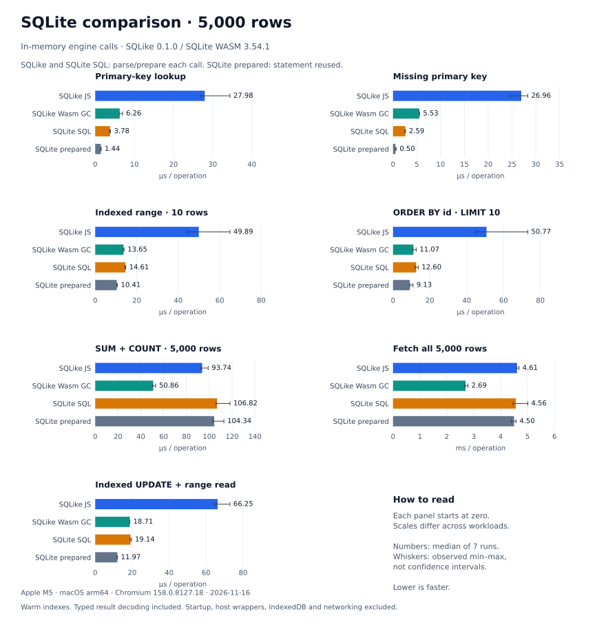

# SQLike

[English](README.md) | **日本語**

ブラウザやNode.jsでSQLを実行できる、MoonBit製のSQLiteサブセットです。インメモリDBとして使うほか、あらかじめ定義したSQLをIndexedDBへ保存しながら実行できます。同期には独立した `@mizchi/litestream` を組み合わせます。

## できること

| 用途 | 提供する機能 |
| --- | --- |
| アプリ内のSQLデータベース | CRUD、JOIN、集約、RETURNING、transaction、index、FK、基本trigger |
| オフラインでの保存・再開 | 固定schemaとnamed statementを使うIndexedDB保存。接続やページを開き直して再開 |
| 配信する機能の選択 | SQLパーサを含まない実行、独自生成runtimeの注入、compiler・SQLite出力・Drizzleの別entry |
| Drizzleとの連携 | 型付きクエリ、RETURNING、migration、入れ子transaction |
| サーバーとの同期 | SQL / SQLite Session差分、再送、重複排除、利用側で記述する適用・競合policy |
| SQLite・LTXとの受け渡し | SQLite画像の書き出し、LTX v3の生成・適用 |

## インストール

JavaScript / TypeScript向けに、[SQLike](https://www.npmjs.com/package/@mizchi/sqlike)と[Litestream](https://www.npmjs.com/package/@mizchi/litestream)をnpmで公開しています。ESM、Node.js 24以上と現行ブラウザ向けです。実行にMoonBitコンパイラは不要です。

```sh
pnpm add @mizchi/sqlike
# 同期・LTXも使う場合
pnpm add @mizchi/litestream
```

[GitHub Releases](https://github.com/mizchi/sqlike/releases/tag/v0.1.0)にも配布用アーカイブを用意しています。

## バンドルサイズ

ブラウザ向けの公開entryをOxcでminifyした配布物の合計です。JSローダー・分割chunk・生成されるWorker・Wasmを含み、Brotliは各ファイルをquality 11で圧縮して合算しています。1 KiB = 1,024 bytes。Wasmはrelease出力を使用します。

SQLikeはnpm 0.1.0以後の未リリース変更を含む現行ソースで計測しています。[段階的な互換機能の導入](docs/internal/staged-sqlite-compatibility.md)に追加内容とサイズ差を記録します。

[](docs/images/bundle-size.png)

横軸は対数目盛で、1目盛ごとにサイズが2倍になります。点に記載した数値はKiBです。

<details>
<summary>数値を表で見る（10構成）</summary>

<!-- bundle-size:start -->
| ビルド | minified・未圧縮 | Brotli |
| --- | ---: | ---: |
| SQLike 0.1.0 (source) / 通常SQL / JS | 602.13 KiB | 113.79 KiB |
| SQLike 0.1.0 (source) / 通常SQL / Wasm GC | 533.01 KiB | 167.65 KiB |
| SQLike 0.1.0 (source) / 事前定義・全実行機能 / JS | 491.18 KiB | 98.54 KiB |
| SQLike 0.1.0 (source) / 事前定義・全実行機能 / Wasm GC | 437.03 KiB | 141.07 KiB |
| SQLike 0.1.0 (source) / 事前定義・JSON・日時・windowなし / JS | 455.04 KiB | 90.85 KiB |
| SQLike 0.1.0 (source) / 事前定義・JSON・日時・windowなし / Wasm GC | 408.66 KiB | 130.82 KiB |
| SQLike 0.1.0 (source) / 事前定義・主キー索引のみ / JS | 433.74 KiB | 86.87 KiB |
| SQLike 0.1.0 (source) / 事前定義・主キー索引のみ / Wasm GC | 390.82 KiB | 125.81 KiB |
| sqlite-wasm 3.54.1-build1 | 1313.74 KiB | 462.33 KiB |
| Turso 0.8.3 | 11709.66 KiB | 2675.96 KiB |
<!-- bundle-size:end -->

</details>

事前定義版はSQLパーサを含みません。機能選択版とWasm GC版は、同じ公開host APIを使うカスタムビルドです。「主キー索引のみ」は任意機能の選択で、CRUD・集約・CTE・secondary indexはコアに残ります。SQLikeはSQLiteサブセットのため、他のエンジンと機能範囲は異なります。

表は手動の機能プロファイルです。[catalog別のビルド](docs/catalog-build.md)では、未使用のcore関数群と文の実装も除去できます。そちらの計測はランタイム単体として別に記録しています。

アプリのHTML・コード、事前ビルドしたschema / statement、ビルド時compiler、任意のSQLite exporter、Litestreamは含みません。任意Workerも含む配布assetの合計であり、初回起動時の最小ダウンロード量とは異なります。各行の計測済みminified bundleはChromiumでDBを開いて書込・読取まで確認しています。

比較対象は[@sqlite.org/sqlite-wasm](https://www.npmjs.com/package/@sqlite.org/sqlite-wasm)と[@tursodatabase/database-wasm](https://www.npmjs.com/package/@tursodatabase/database-wasm)です。

[計測条件・ファイル別サイズ](measurements/bundle-size-current.json)。再計測は`just bundle-size`で行えます。

## SQLiteとの速度比較

5,000行のテーブルでの**μs/操作**（小さいほど高速）、ウォームアップ後7サンプルの中央値です。通常SQLは毎回SQLをパース・prepareし、prepared列はSQLiteのstatementを再利用します。

[](docs/images/sqlite-benchmark.png)

各グラフの軸はゼロ始まりですが、処理ごとに目盛幅が異なります。棒は中央値、ひげは7サンプルの最小〜最大です。全件取得のみ単位をmsにしています。画像をクリックするとPNG版を開けます。

<details>
<summary>数値を表で見る（7処理・4経路、単位はすべてμs）</summary>

<!-- sqlite-benchmark:start -->
| 処理 | SQLike JS・通常SQL | SQLike Wasm GC・通常SQL | SQLite WASM・通常SQL | SQLite WASM・prepared |
| --- | ---: | ---: | ---: | ---: |
| 主キーで1行検索 | 31.37 | 7.27 | 4.28 | 1.63 |
| 存在しない主キーの検索 | 28.03 | 6.24 | 2.80 | 0.52 |
| 二次索引の範囲検索・10行 | 55.29 | 14.86 | 16.22 | 11.68 |
| ORDER BY id LIMIT 10 | 50.68 | 12.03 | 13.44 | 10.38 |
| sum(n), count(*) | 103.16 | 55.10 | 116.46 | 112.79 |
| 全5,000行取得 | 5,180.00 | 2,994.44 | 5,180.00 | 5,220.00 |
| 索引列の更新＋範囲10行取得 | 70.35 | 19.74 | 20.27 | 13.40 |
<!-- sqlite-benchmark:end -->

</details>

2026-11-16、Apple M5 / macOS arm64 / Chromium 158.0.8127.18で計測。SQLike 0.1.0以後の現行ソースのMoonBit release出力（JSはminify前）と、SQLite WASM 3.54.1を同じページ内のインメモリDBで実行しています。

主キー・二次索引はウォーム状態です。更新の行は索引列の値を交互に変更し、その後の範囲検索までを含みます。結果の型変換と復号を含むエンジンAPIの比較で、host wrapper、起動・Wasmコンパイル、IndexedDB、通信は含みません。計測前後にnative SQLite由来の期待値と更新結果を照合しています。

通常SQLではパースとホスト境界のコストがあり、特に小さな検索でSQLiteとの差が残っています。実アプリの速度はクエリ・返却行数・永続化方式でも変わります。

[生データ・クエリ・全サンプル](measurements/sqlite-speed-current.json)。再計測は`just sqlite-bench --profiles=false`で行えます。

## SQLを実行する

```ts
import { openDatabase } from '@mizchi/sqlike';

const db = openDatabase();
db.run('CREATE TABLE task(id INTEGER PRIMARY KEY,title TEXT NOT NULL)');

const rows = db.values(
  'INSERT INTO task VALUES(?,?) RETURNING id,title',
  [1n, '買い物メモ'],
);
// [[1n, '買い物メモ']]

const tasks = db.all('SELECT id,title FROM task ORDER BY id');
// [{ id: 1n, title: '買い物メモ' }]

db.transaction(() => {
  db.run('UPDATE task SET title=? WHERE id=?', ['更新したメモ', 1n]);
});
db.close();
```

`openDatabase()`はインメモリです。INTEGERは`bigint`、REALは`number`、BLOBは`Uint8Array`で扱います。`values()`は列位置順の配列、`all()`は列名をキーとするオブジェクトを返します。同名の結果列がある場合は`values()`を使います。

[SQLの対応範囲と値の扱い](docs/sql.md)

## IndexedDBへ保存する

ブラウザで使うschemaと問い合わせが決まっている場合は、ビルド時にDDLとnamed statementをコンパイルできます。実行側はバイナリ定義を読み込み、SQLパーサを配信せずに動きます。

未リリースの現行ソースでは、[catalogから必要な機能を自動推定](docs/catalog-build.md)し、未使用のcore関数群・文の実装を除去できます。

```ts
import { DefinedDatabase } from '@mizchi/sqlike/defined';
import { catalog } from './catalog.generated.js';

const db = await DefinedDatabase.open('tasks', catalog);
await db.execute('add', [1n, 'オフラインで書いたメモ']);
const tasks = await db.prepare('list').all();
await db.close();
```

同じ名前とcatalogで開き直すと、保存したデータを読み込みます。保存先は差し替え可能です。保存データと異なるschemaを自動で読み替えることはありません。

[catalogの作成・永続化・SQLite出力](docs/prepared.md)

## Drizzleを使う

```sh
pnpm add drizzle-orm@0.45.4
```

```ts
import { openDatabase } from '@mizchi/sqlike';
import { drizzle } from '@mizchi/sqlike/drizzle';

const client = openDatabase();
const db = drizzle(client);
```

Drizzleは任意のentryです。通常のSQLや固定schemaの実行だけなら追加は不要です。

[テーブル定義・migration・transaction](docs/drizzle.md)

未リリースの現行ソースでは、[Drizzleクエリを事前定義catalogへ変換](docs/drizzle-prepared.md)し、ブラウザへORMとSQL parserを配信しない構成も使えます。

## 同期・LTXを使う

`@mizchi/litestream`はDBドライバーの契約を通じて同期します。SQLike・SQLite・Tursoとの構成例があり、Node、Cloudflare Durable Objects、P2Pリレーを正本や中継として使えます。利用できる同期方式は各driverの能力に依存します。

競合時には、利用側で適用・保留・拒否・置換を判断できます。LTXの生成・適用だけを使う場合は、`@mizchi/litestream/ltx`をimportします。

[同期の組み込み・競合処理・LTX](docs/sync.md)

## 利用上の制約

- ブラウザでの確認対象は現在Chromiumです。
- SQLite全機能互換ではありません。SQL・関数・PRAGMAには対応範囲があります。
- IndexedDB保存を使う場合も、クエリの実行中は行データをメモリに保持します。
- 固定schemaの実行では、実行時の任意DDLやschema変更の自動migrationは扱いません。
- 同期先の認証・認可、driverの選択、競合時の業務判断はアプリ側で用意します。

## MoonBitから使う

Mooncakesの2モジュールを単独で使えます。

```sh
moon add mizchi/sqlike@0.1.0
moon add mizchi/litestream@0.1.0
```

[SQLikeのAPI](packages/sqlike/README.md) / [LitestreamのAPI](packages/litestream/README.md)

MIT License。[リリース](https://github.com/mizchi/sqlike/releases) / [ユーザー向けガイド](docs/README.md) / [開発者向けドキュメント](docs/internal/README.md)
