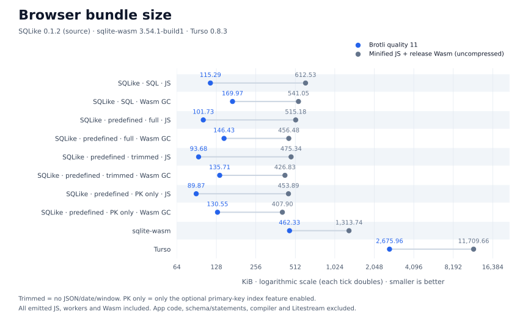
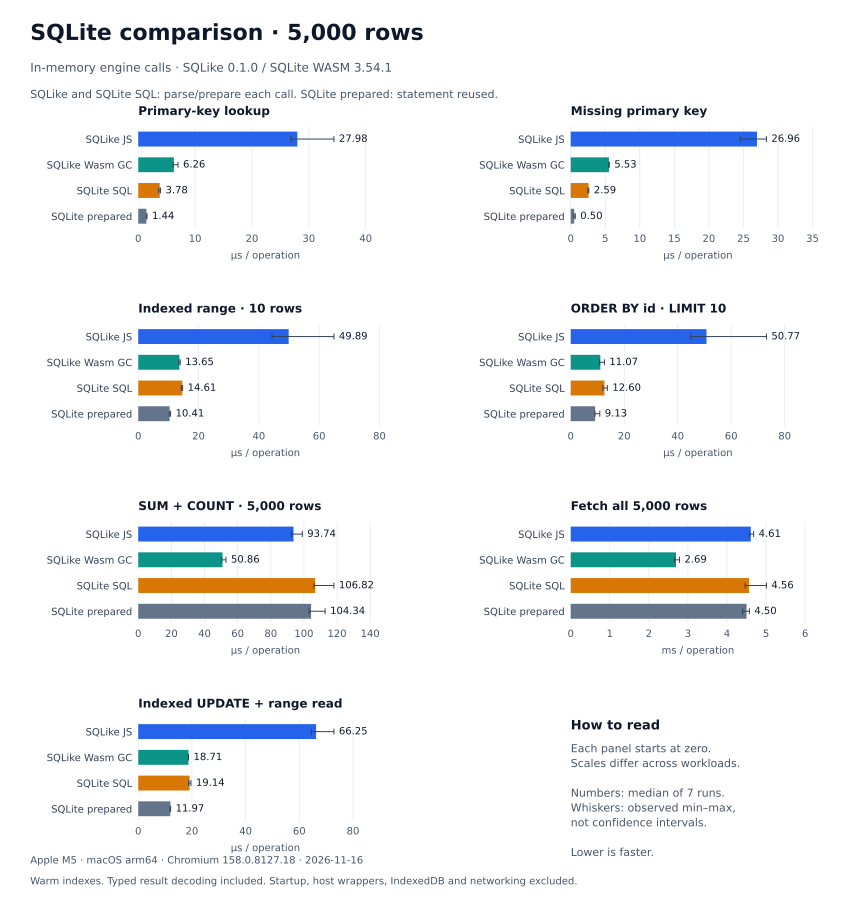

# SQLike

**English** | [日本語](README.ja.md)

A SQLite subset written in MoonBit for browsers and Node.js. Run SQL in memory, or execute predefined statements with IndexedDB persistence for offline use. Add the separate `@mizchi/litestream` package for synchronization.

## Features

| Use case | Available features |
| --- | --- |
| An embedded SQL database | CRUD, JOINs, aggregates, RETURNING, transactions, indexes, foreign keys, and basic triggers |
| Offline persistence and reopening | IndexedDB storage for predefined schemas and named statements; reopen connections or reload the page to resume |
| Smaller browser runtimes | Execution without the SQL parser, custom runtime injection, and separate entries for the compiler, SQLite export, and Drizzle |
| Drizzle integration | Typed queries, RETURNING, migrations, and nested transactions |
| Server synchronization | SQL and SQLite Session changesets, retries, deduplication, and application-defined apply and conflict policies |
| SQLite and LTX interchange | SQLite image export and LTX v3 generation and application |

## Installation

[SQLike](https://www.npmjs.com/package/@mizchi/sqlike) and [Litestream](https://www.npmjs.com/package/@mizchi/litestream) are available on npm. Both use ESM and target Node.js 24+ and current browsers. A MoonBit compiler is not required at runtime.

```sh
pnpm add @mizchi/sqlike
# For synchronization and LTX support:
pnpm add @mizchi/litestream
```

Archives are also available from [GitHub Releases](https://github.com/mizchi/sqlike/releases/tag/v0.1.0).

## Bundle size

Sizes include the browser entry's JS loader, split chunks, emitted workers, and Wasm. JS is minified with Oxc; Wasm uses release output. Brotli quality 11 is applied to each file before summing. 1 KiB = 1,024 bytes.

SQLike measurements use the current source checkout, including unreleased changes after npm 0.1.0. [Staged compatibility work](docs/internal/staged-sqlite-compatibility.md) records the additions and their size cost.

[](docs/images/bundle-size.png)

The horizontal axis is logarithmic: each tick doubles the size. Labels show KiB.

<details>
<summary>View exact sizes (10 builds)</summary>

<!-- bundle-size:start -->
| Build | minified, uncompressed | Brotli |
| --- | ---: | ---: |
| SQLike 0.1.0 (source) / SQL / JS | 601.98 KiB | 113.76 KiB |
| SQLike 0.1.0 (source) / SQL / Wasm GC | 533.02 KiB | 167.36 KiB |
| SQLike 0.1.0 (source) / Predefined, all execution features / JS | 491.03 KiB | 98.42 KiB |
| SQLike 0.1.0 (source) / Predefined, all execution features / Wasm GC | 436.93 KiB | 140.90 KiB |
| SQLike 0.1.0 (source) / Predefined, no JSON/date/window / JS | 454.43 KiB | 90.83 KiB |
| SQLike 0.1.0 (source) / Predefined, no JSON/date/window / Wasm GC | 408.78 KiB | 130.84 KiB |
| SQLike 0.1.0 (source) / Predefined, primary-key index only / JS | 433.13 KiB | 86.79 KiB |
| SQLike 0.1.0 (source) / Predefined, primary-key index only / Wasm GC | 390.19 KiB | 125.75 KiB |
| sqlite-wasm 3.54.1-build1 | 1313.74 KiB | 462.33 KiB |
| Turso 0.8.3 | 11709.66 KiB | 2675.96 KiB |
<!-- bundle-size:end -->

</details>

Predefined builds omit the SQL parser. Feature-selected and Wasm GC variants are custom builds using the same public host API. “Primary-key index only” refers to optional features: CRUD, aggregates, CTEs, and secondary indexes remain in the core. SQLike implements a SQLite subset, so its feature coverage differs from the other engines.

These totals exclude application HTML and code, precompiled schemas and statements, the build-time compiler, the optional SQLite exporter, and Litestream. They include optional emitted workers and do not represent the minimum startup download. Every measured minified bundle was checked in Chromium by opening a database, writing, and reading.

The comparison uses [@sqlite.org/sqlite-wasm](https://www.npmjs.com/package/@sqlite.org/sqlite-wasm) and [@tursodatabase/database-wasm](https://www.npmjs.com/package/@tursodatabase/database-wasm).

[Measurement conditions and per-file sizes](measurements/bundle-size-current.json). Reproduce with `just bundle-size`.

## SQLite performance comparison

Results are **μs per operation** on a 5,000-row table, using the median of seven samples after warmup. Ordinary SQL paths parse or prepare on each call; the prepared column reuses SQLite statements.

[](docs/images/sqlite-benchmark.png)

Each panel starts at zero and uses its own scale. Bars show medians; whiskers show the observed minimum and maximum across seven samples. Only the full-table fetch panel uses milliseconds. Click either figure for its PNG version.

<details>
<summary>View exact timings (7 workloads, 4 execution paths; all values in μs)</summary>

<!-- sqlite-benchmark:start -->
| Workload | SQLike JS, SQL | SQLike Wasm GC, SQL | SQLite WASM, SQL | SQLite WASM, prepared |
| --- | ---: | ---: | ---: | ---: |
| Primary-key lookup | 27.47 | 6.46 | 3.69 | 1.48 |
| Missing primary key | 27.70 | 5.84 | 2.66 | 0.50 |
| Indexed range · 10 rows | 48.55 | 13.58 | 14.40 | 10.59 |
| ORDER BY id · LIMIT 10 | 46.48 | 10.87 | 12.33 | 9.23 |
| SUM + COUNT · 5,000 rows | 96.21 | 51.08 | 110.31 | 107.53 |
| Fetch all 5,000 rows | 4,863.64 | 2,689.47 | 4,583.33 | 4,541.67 |
| Indexed UPDATE + range read | 69.98 | 20.37 | 19.91 | 12.56 |
<!-- sqlite-benchmark:end -->

</details>

Measured on November 16, 2026, with an Apple M5, macOS arm64, and Chromium 158.0.8127.18. SQLike source after 0.1.0, built with MoonBit release output (JS before minification), and SQLite WASM 3.54.1 run in memory on the same page.

Primary-key and secondary indexes are warm. The update workload alternates indexed values and includes the following range read. Timings cover engine API calls, including typed result conversion and decoding. They exclude host wrappers, startup, Wasm compilation, IndexedDB, and networking. Results and update effects are checked against expectations from native SQLite before and after timing.

Parsing and the host boundary add overhead to ordinary SQL calls; small lookups still show a gap against SQLite. Application performance also depends on the query, returned row count, and persistence method.

[Raw data, queries, and all samples](measurements/sqlite-speed-current.json). Reproduce with `just sqlite-bench --profiles=false`.

## Run SQL

```ts
import { openDatabase } from '@mizchi/sqlike';

const db = openDatabase();
db.run('CREATE TABLE task(id INTEGER PRIMARY KEY,title TEXT NOT NULL)');

const rows = db.values(
  'INSERT INTO task VALUES(?,?) RETURNING id,title',
  [1n, 'Shopping list'],
);
// [[1n, 'Shopping list']]

const tasks = db.all('SELECT id,title FROM task ORDER BY id');
// [{ id: 1n, title: 'Shopping list' }]

db.transaction(() => {
  db.run('UPDATE task SET title=? WHERE id=?', ['Updated note', 1n]);
});
db.close();
```

`openDatabase()` creates an in-memory database. INTEGER values use `bigint`, REAL uses `number`, and BLOB uses `Uint8Array`. `values()` returns positional arrays; `all()` returns objects keyed by column name. Use `values()` when result columns share a name.

[SQL coverage and value handling (Japanese)](docs/sql.md)

## Persist to IndexedDB

When your schema and queries are known in advance, compile the DDL and named statements during the build. The browser loads binary definitions and executes them without shipping the SQL parser.

```ts
import { DefinedDatabase } from '@mizchi/sqlike/defined';
import { catalog } from './catalog.generated.js';

const db = await DefinedDatabase.open('tasks', catalog);
await db.execute('add', [1n, 'Written offline']);
const tasks = await db.prepare('list').all();
await db.close();
```

Reopening with the same database name and catalog restores saved data. The storage implementation is replaceable. A schema that differs from the stored schema is not applied automatically.

[Creating catalogs, persistence, and SQLite export (Japanese)](docs/prepared.md)

## Use Drizzle

```sh
pnpm add drizzle-orm@0.45.4
```

```ts
import { openDatabase } from '@mizchi/sqlike';
import { drizzle } from '@mizchi/sqlike/drizzle';

const client = openDatabase();
const db = drizzle(client);
```

Drizzle is an optional entry point. It is not needed for ordinary SQL or predefined-schema execution.

[Table definitions, migrations, and transactions (Japanese)](docs/drizzle.md)

The unreleased source also supports [compiling Drizzle queries into a predefined catalog (Japanese)](docs/drizzle-prepared.md), keeping the ORM and SQL parser out of the browser runtime.

## Synchronization and LTX

`@mizchi/litestream` synchronizes through a database driver contract. Examples cover SQLike, SQLite, and Turso, with Node.js, Cloudflare Durable Objects, or a P2P relay serving as the authority or relay. Available synchronization modes depend on the driver's capabilities.

Applications can decide whether to apply, defer, reject, or replace a conflicting change. Import `@mizchi/litestream/ltx` to use LTX generation and application on their own.

[Integration, conflict handling, and LTX (Japanese)](docs/sync.md)

## Limitations

- Browser validation currently targets Chromium.
- SQLike does not implement every SQLite feature. SQL, functions, and PRAGMAs have defined coverage limits.
- Query execution keeps row data in memory, including when IndexedDB persistence is enabled.
- Predefined-schema execution does not support arbitrary runtime DDL or automatic schema migrations.
- Applications provide synchronization authentication, authorization, driver selection, and domain-specific conflict decisions.

## Use from MoonBit

The two Mooncakes modules can be used independently.

```sh
moon add mizchi/sqlike@0.1.0
moon add mizchi/litestream@0.1.0
```

API documentation (Japanese): [SQLike](packages/sqlike/README.md) / [Litestream](packages/litestream/README.md)

MIT License. [Releases](https://github.com/mizchi/sqlike/releases) / [User guides (Japanese)](docs/README.md) / [Developer documentation (Japanese)](docs/internal/README.md)
