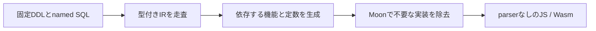

# 登録クエリからランタイムを絞る

0.1.1で追加した機能。固定DDLとnamed queryのcatalogをビルド時に渡すと、必要な任意機能・関数群・文の種類・query処理を推定し、使わない実装をJS / Wasmから除去できます。JSON AOTの`aot`と、バイナリ定義の`defined`に対応します。



## ビルドする

リポジトリのビルドツールを使います。Node 24+とMoonBitが必要です。`catalog`オプションへ、`buildDefinedCatalog()`や`buildCatalog()`と同じ`CatalogSource`を渡します。

```ts
import { readFile } from 'node:fs/promises';
import { defineSqlike, primaryKeyIndex } from './src/sqlike-features.ts';
import { buildSqlikeRuntime } from './scripts/build-sqlike-runtime.ts';
import { buildDefinedCatalog } from './scripts/defined-compiler.ts';

const source = JSON.parse(await readFile('examples/notes/catalog.json', 'utf8'));
const definition = buildDefinedCatalog(source);
const built = await buildSqlikeRuntime(
  defineSqlike({ mode: 'defined', features: [primaryKeyIndex] }),
  { catalog: source, outDir: 'generated/notes/runtime' },
);
console.log(built.requirements);
// functionGroups: ['aggregates']
// statements: ['delete', 'insert', 'select', 'update']
// queryParts: []
```

事前に`pnpm build:core`でcompilerをビルドします。`definition`は[固定DDLとprepared statement](prepared.md)と同じ定義データで、ランタイムとは別に配信します。ブラウザでは生成したruntimeを`createDefinedDatabase()`へ注入します。`aot`モードの場合は、同じsourceから作った`buildCatalog(source).artifact`を`openCompiled()`へ渡します。

```ts
import * as runtime from './generated/notes/runtime/runtime.js';
import { createDefinedDatabase } from '@mizchi/sqlike/defined/core';
import { catalog as definition } from './catalog.generated.js';

const DB = createDefinedDatabase(runtime);
const db = await DB.open('notes', definition); // definitionは配信した定義データ
await db.execute('add', [1n, 'hello', 0n]);
```

Wasmには`@mizchi/sqlike/defined/wasm`の`definedWasm(instance.exports)`を注入します。定義・保存形式は変更せず、既存のIndexedDB、snapshot、delta、オフライン再開の契約を使えます。

CLIではprofileファイルの`catalog`にsourceのパスを指定できます。パスの基準はprofileファイルのディレクトリです。sourceオブジェクトを直接埋め込むこともできます。

```json
{
  "mode": "defined",
  "features": ["primaryKeyIndex"],
  "catalog": "../notes/catalog.json"
}
```

```sh
pnpm build:core
just sqlike-runtime examples/profiles/notes-catalog-defined.json generated/notes/runtime
```

## 何を残すか

登録した全クエリに加え、固定schemaのDEFAULT・CHECK・view・index式・部分indexの条件・trigger本体を走査します。bind値によって通る分岐が変わっても動作するよう、未実行CASEや空テーブルの式も対象にします。文字列・コメント中にある関数名は対象になりません。FKのcascadeなど、選択した実装から内部的に必要な処理はリンク時の依存として残ります。

| 選択単位 | 扱い |
| --- | --- |
| JSON・日時・window・STRICT・FK・trigger・外部結合・索引metadata・FILTER | 必要な既存feature tokenを自動追加 |
| core関数群 | GLOB、LIKE、char、substring、trim、roundなどを個別に除去。lower/upper、min/maxなどは実装を共有する単位で選択 |
| 通常の集約・group_concat | 別の関数群として選択。window集約に必要な依存も収集 |
| SQL JSON | 正規化・生成・読取・矢印演算子・編集・patch・集約の7群で選択 |
| JOIN・通常CTE・再帰CTE・複合SELECT | それぞれ独立に選択。FROM subqueryは内部でCTEへ変換されるため、CTEも含める |
| JSON subtypeの再解析 | JSONを入れ子にするVALUE引数に必要なときだけ選択 |
| SELECT / INSERT / UPDATE / DELETE / transaction / PRAGMA | 登録クエリとtrigger本体に必要な文の実装を選択 |
| 主キー索引 | 性能とメモリの選択なので、`primaryKeyIndex`で明示指定 |
| SQLite出力・LTX | `sqlitePages` / `ltx`を明示指定。`defined`は従来どおり別exporterを使用 |

`catalog`を省くと従来の手動プロファイルになります。指定した`features`は、自動推定した必須機能へ追加されます。catalogを渡した場合、その機能の中の関数群・query処理はcatalogから選びます。`sqlJson`を明示しても、未使用のJSON関数群をすべて残す指定にはなりません。

SQLの型変換・比較、汎用のquery実行器は共通に残ります。日時・window内部の各関数は、既存の大きな機能単位で残ります。クエリごとの専用機械語へ変換する仕組みではありません。

### JSONの生成だけを使う場合

`SELECT json_array(?),json_object('x',?)`ではSQL JSONパーサ・パス解析・編集・patch・集約を除去します。`json_array(json_object('x',1))`のようにJSON結果を入れ子にする場合は、型付きIRから`jsonSubtype`を検出して再解析処理を残します。`json_object(json_array(1),2)`の第1引数はラベル、`json_extract(json_array(1),'$')`の第1引数はJSON文書なので、VALUE引数の再解析依存には含めません。bind・結果・保存画像のJSON ABIは引き続き利用できます。

JSON subtypeは、通常のTEXTとJSON関数の結果を区別するための情報です。`COLLATE`・単項`+`・TEXTキャスト・CASE・coalesce・iif・nullif経由の引継ぎを本家と照合しています。JSON VALUE引数がJSON結果を返し得るscalar subqueryやmin/maxを経由する場合は、正確な型情報の追跡が未対応のため`unsupported JSON subtype propagation`で拒否します。通常の文字列を返すscalar subqueryや、JSON文書として解析する引数は利用できます。[SQLiteのJSON引数の規則](https://www.sqlite.org/json1.html#value_arguments)も参照してください。

## 生成結果を調べる

`profile.json`の`requirements`に次を記録します。

- `artifactSHA256` / `sourceSHA256`: 解析した定義とsourceの再現用hash
- `features`: 自動推定した意味上の必須機能
- `functions` / `functionGroups`: 検出した呼出し名と、実装を選ぶ単位
- `statements`: 必要な文の種類
- `queryParts`: `join` / `cte` / `recursiveCte` / `compound` / `jsonSubtype`の依存

解析だけなら、Node用の`@mizchi/sqlike/compiler`から実行できます。`analyzeCatalogRequirements()`は0.1.1から利用できます。

```ts
import { analyzeCatalogRequirements } from '@mizchi/sqlike/compiler';
const requirements = analyzeCatalogRequirements(source);
```

解析器は[バイナリの型契約](../src/binary-wire.json)から生成する型付きvisitorです。[関数群の契約](../src/runtime-capabilities.json)とともに再生成・hashを検証し、SQLの文字列検索には依存しません。

除去した機能を使う別catalogは、ロード時に`catalog capability disabled`で拒否します。クエリを追加したら再ビルドしてください。同じ選択単位に収まるcatalogは使えます。profileのhashは再現用の情報で、認可の境界としては使いません。定義・保存画像のschema / program identityは従来の契約で検査します。

## 容量と検証

<!-- catalog-size:start -->
| Catalog / mode | JS minified 前→後 | JS Brotli 前→後 | Wasm Brotli 前→後 |
| --- | ---: | ---: | ---: |
| readonly / aot | 473.64→402.62 KiB | 88.76→75.25 KiB | 132.58→112.17 KiB |
| readonly / defined | 443.06→373.24 KiB | 85.95→72.71 KiB | 126.49→106.35 KiB |
| scalar-read / aot | 473.64→405.39 KiB | 88.76→75.81 KiB | 132.58→113.28 KiB |
| scalar-read / defined | 443.06→376.01 KiB | 85.95→73.30 KiB | 126.49→107.53 KiB |
| json-construct / aot | 497.21→408.91 KiB | 92.86→76.48 KiB | 138.25→113.95 KiB |
| json-construct / defined | 466.62→379.48 KiB | 89.91→73.67 KiB | 132.47→108.04 KiB |
| json-nested / aot | 497.21→413.64 KiB | 92.86→77.08 KiB | 138.25→115.28 KiB |
| json-nested / defined | 466.62→384.14 KiB | 89.91→74.52 KiB | 132.47→108.92 KiB |
| json-cte / aot | 497.21→422.08 KiB | 92.86→78.64 KiB | 138.25→117.80 KiB |
| json-cte / defined | 466.62→392.58 KiB | 89.91→76.00 KiB | 132.47→111.58 KiB |
| notes / aot | 473.64→434.04 KiB | 88.76→81.19 KiB | 132.58→120.96 KiB |
| notes / defined | 443.06→404.38 KiB | 85.95→78.60 KiB | 126.49→115.14 KiB |
<!-- catalog-size:end -->

比較はランタイム単体です。同じ意味上のfeature・主キー索引・公開exportsを使い、通常プロファイルとcatalog指定を比べます。Oxc minify後のJS、release Wasm、ファイルごとのBrotli quality 11を集計します。host・IndexedDB wrapper・定義データ・compilerを含まないため、READMEのアプリ配信量とは範囲が異なります。

[前回の自動選択版（70b0c88）](../measurements/catalog-parts-before.json)との比較では、readonly / definedのJS minifiedが369.09→357.70 KiB、Brotliが72.64→70.59 KiBとなりました。この差は、表の通常プロファイルからの削減量とは別の比較です。新しいJSON fixtureは、通常プロファイルでJSON全体を有効にした構成と比較しています。

```sh
just catalog-profiles
```

[計測JSON](../measurements/catalog-profiles-current.json)は全fixtureを通常 / 自動選択のJS・Wasmで本家と照合します。[単体差分](../tests/sqlike-catalog-profile.test.ts)は関数群の個別選択、未実行分岐、trigger、FK cascade、SQL transaction、余分な機能を持つcatalogの拒否を検査します。[JSON](../tests/sqlike-json-profile.test.ts)と[JOIN / CTE / 複合SELECT](../tests/sqlike-query-profile.test.ts)はAOT / definedの両方で実装の除去と本家の結果を検査します。[Chromium](../e2e/catalog-profile.spec.ts)では、選択したCTE＋JSON生成のruntimeだけを配信し、オフライン書込とIndexedDB再開を検証します。
