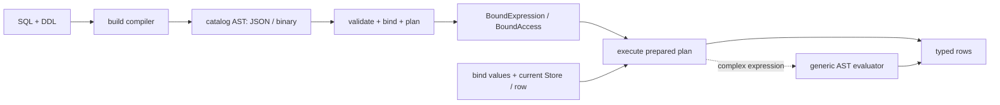

# AOTの準備済み実行計画

2026-11-17、0.1.1以降の変更。[UPDATEメタデータ共有](aot-update-metadata.md)に続き、解析用ASTと実行用IRを分離した。公開APIとJSON / binaryのcatalog・保存形式は維持する。



## 準備するものと実行時の状態

`prepare_compiled_program`は固定schemaの名前・機能・出力列を検査した後、内部の`BoundExpression`・`BoundAccess`を作る。このIRはホスト入力からdeserializeせず、SQLやbind文字列からJavaScriptコードを生成する処理も追加しない。schema由来の位置・型規則だけをProgramで保持する。

| 準備時に確定するもの | 実行時に取得・評価するもの |
| --- | --- |
| 表のslot、列のslot、hidden rowidの区別 | 現在のStore・行・parameter値 |
| 比較のaffinity / collation、IS TRUE / FALSEの扱い | NULL・値のstorage class・型変換・比較結果 |
| rowid / 全主キー等価検索 / scanのアクセス方式 | 現在の派生索引、bindから作る検索キー |
| SETの代入位置・affinity、RETURNINGの出力metadata | SET右辺、RETURNING値、制約・FK・trigger |

`BoundInput`は一行・一回の実行だけの状態で、Programには保持しない。基本式はStoredRowのslotから値を読み、一般評価器が必要な場合だけ行Environmentを作る。制約・trigger等の別処理までEnvironment生成をなくしたという意味ではない。clone / restore / rollback後も表と索引は現在のStoreから取得する。

演算子・比較・主キー値の正規化は、汎用評価器と共通の値演算関数を使う。解析器側の`Expr`へslot用のvariantを追加せず、既存のwire形式を変えない。trigger本体のOLD / NEW参照は汎用の意味検証で扱い、固定schemaのslot束縛へ混ぜない。

## 今回の実行範囲

- UPDATE：predicate、SET右辺、RETURNINGを準備済みIRへ変換。列・parameter・literal、基本の単項 / 二項演算、比較、CAST / COLLATEを直接扱う。複雑なCASE・関数・subquery等は検証済みASTによる評価へ戻す。
- 主キーアクセス：rowid / INTEGER PRIMARY KEY、または全主キー列のAND等価条件を準備する。複合キーのaffinity・collationも保持する。条件全体は再評価し、残余条件を省略しない。
- SELECT：単一の物理表、単純な列 / `*` / literalの射影、主キー等価検索の専用経路を追加。LIMIT / OFFSETは現在の値を確認する。対応するbind型でなければ既存の検証・実行へ戻す。
- JOIN・集約・CTE・compound・範囲索引・複雑なORDER BY、INSERT / DELETEは既存経路を維持する。全SQLを専用命令列へ変換した実装ではない。

## 値とコードの境界

配信するcatalogはアプリのビルド成果物とし、利用時には登録名とbind値を渡す。未登録のSQL文字列をquery名に渡しても実行しない。SQL断片を含む文字列、HTML、script文字列はTEXT値として保存・読出しする。値からquery構造を作らないことがSQLインジェクション対策の中心となる。[OWASP SQL Injection Prevention](https://cheatsheetseries.owasp.org/cheatsheets/SQL_Injection_Prevention_Cheat_Sheet.html)

XSSは画面への出力境界で扱う。DB層でHTMLエスケープすると保存値やSQL比較の意味が変わるため、原文を返す。通常の要素へ文字列を表示するときは、デモのように`textContent`を使う。HTMLを解釈する表示が必要なら、その表示用途の対策を別に行う。[OWASP Cross Site Scripting Prevention](https://cheatsheetseries.owasp.org/cheatsheets/Cross_Site_Scripting_Prevention_Cheat_Sheet.html)

[`tests/aot-update.test.ts`](../../tests/aot-update.test.ts)でSQL断片・HTMLのbindと未知のquery名を検査する。[Chromiumの追加E2E](../../e2e/lite.spec.ts)はフォームからUPDATEし、HTML文字列が要素にならず、オフライン再読込後も同じ文字列として表示されることを確認する。これはDBのprepared処理だけでXSSを防ぐという主張ではない。

## 性能・容量と検証

比較対象は前段のmetadata共有を入れたローカルビルドの保存済み成果物。0.1.1 tagそのものとの比較ではない。[変更前の測定記録](../../measurements/bound-plan-before/aot-update-current.json)と成果物hashを照合し、同じページでJSON / binaryのJS / Wasmを比較する。catalog選択後の4経路は新baselineとして別に記録する。

ベンチにはUPDATEだけでなく、主キーSELECTのhit / missも追加した。返り値を計時中の最後の実行から保持し、native SQLiteで全行とSELECT / RETURNINGの型付き結果を検査する。全サンプル・hashは[`aot-update-current.json`](../../measurements/aot-update-current.json)、SQLiteとの比較は[`sqlite-speed-current.json`](../../measurements/sqlite-speed-current.json)。保存・通信・起動はengine内の時間と分ける。

<!-- bound-plan-results:start -->
5,000行、µs/操作、7サンプル中央値。同じ経路の前段metadata共有版 → 実行用IR版。

| 経路 | SELECT hit | SELECT miss | UPDATE実変更（非索引列） | UPDATE＋式・RETURNING |
| --- | ---: | ---: | ---: | ---: |
| JSON / JS | 2.22 → 2.01 | 1.13 → 0.99 | 3.25 → 2.70 | 5.98 → 3.72 |
| JSON / Wasm | 1.53 → 1.46 | 0.92 → 0.83 | 2.89 → 2.27 | 5.91 → 3.04 |
| binary / JS | 2.17 → 2.06 | 1.13 → 1.00 | 3.31 → 2.76 | 6.04 → 3.83 |
| binary / Wasm | 1.52 → 1.44 | 0.90 → 0.81 | 2.84 → 2.18 | 5.84 → 2.92 |

非索引列の実変更UPDATEは約17〜23%、式＋RETURNINGは約37〜50%短縮した。SELECTの改善は小さく、前後のsample範囲が重なる場合もあるため、全入力への一定の改善率は主張しない。

容量はengine単体のJS、minify後未圧縮 / Brotli quality 11、単位B。host・Worker・catalogは含めない。

| 対象 | minified 前→後 | Brotli 前→後 | Brotli増分 |
| --- | ---: | ---: | ---: |
| AOT + SQLite writer + LTX | 579,314 → 595,044 | 109,736 → 111,886 | +2,150 |
| SQLike dynamic SQL | 620,753 → 623,870 | 116,444 → 117,132 | +688 |
| selected defined / readonly | 368,429 → 381,130 | 72,317 → 74,371 | +2,054 |
| selected defined / notes | 397,308 → 413,023 | 78,146 → 80,100 | +1,954 |

readonlyでもSELECTの実行用IR・主キーアクセスが追加される。一方、UPDATE専用の準備・適用関数は除去される。追加metadataだけの実heap量は分離計測していない。完全に束縛できる式のEnvironment遅延生成を検査したもので、DB全体の常駐量削減の保証ではない。

別に採取した1,000行JS UPDATEのprofileでは、名前解決への帰属が6.1%、行Environmentが4.8%、JSONが26.4%だった。各1秒のsampling結果であり、割合の差をそのまま短縮時間とは解釈しない。

MoonBit各57件、Node 374件、既存Chromium 58件＋追加のフォーム / offline表示1件、型・strict checkを通過。厳密差分566ケース×8経路は不一致0、出力監査も各環境454一致・248 atomic拒否・誤出力0を維持した。新しいnative比較の行列は4経路でINTEGER / REAL / TEXT / NULL / BLOB、比較式とLIMIT / OFFSETを切り替える。SQLite全機能互換の判定は引き続きincompatibleである。
<!-- bound-plan-results:end -->

列slot・lazy Environmentは[whiteboxテスト](../../packages/sqlike/src/bound_plan_wbtest.mbt)で確認する。native差分は各storage class、数値変換、NOCASE / BINARY / RTRIM、CAST / unary plus、NULL、shadowされたTRUE / FALSE、hidden rowid、複合主キー、LIMIT型切替を含む。既存の失敗後状態・trigger / FK・savepoint・clone / restore、binary / catalog選択ビルドの検査も維持する。

次は、範囲索引・sort / LIMITの準備済み計画、関数やCASEの引数内部のslot化、INSERT / DELETEへの拡張が候補。runtimeのサイズと差分結果を各段階で確認する。

```sh
just p0-measure
just aot-update-bench --before-dir=/tmp/sqlike-bound-before
LITESTREAM_BIN=/path/to/litestream just p0-check
just bundle-size
```
