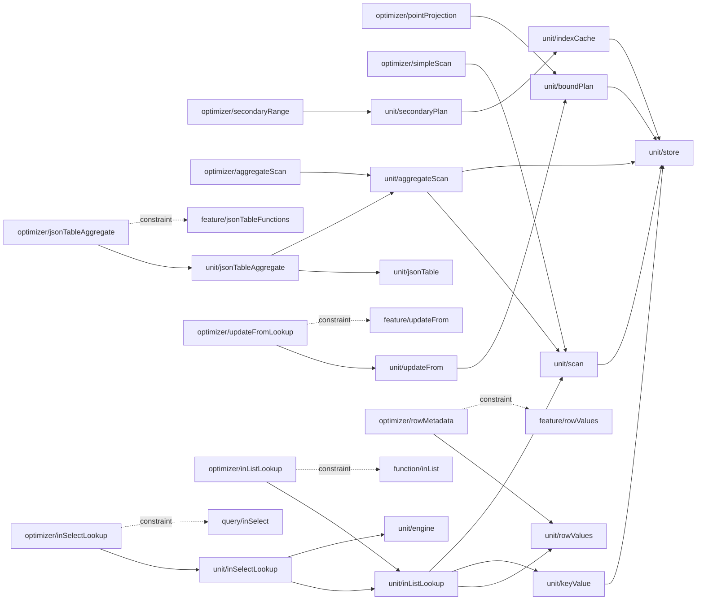

# SQLikeのビルド契約

未リリース。利用方法は[build-targets.md](../build-targets.md)。

## 単一の契約から2種類の出力

`src/sqlike-build-graph.json`が機能、関数群、文、query、optimizer、公開API、実装領域の宣言です。現在は125ノード・160本のrequires辺を持ちます。`generate-build-graph.ts`からTS定数と[完全なMermaidグラフ](sqlike-build-graph.mmd)を生成します。これはcapabilityの依存グラフで、全関数のcall graphではありません。

`src/sqlike-build-plan.ts`はcatalogのtyped IRから得た必要機能と明示指定をrootにして、最小の依存閉包とBool定数を作ります。`build-plan.json`にroot、selected、定数、optimizer、出力方式を記録します。型だけでなく、不明な名前・欠けた依存・循環も実行時に検査します。`inSelect`・`aggregateRepresentative`は意味上のquery part、`format`は関数群として推論し、`inSelectLookup`等のoptimizerと分けます。不要なcatalogから実装を除去し、必要能力を欠くruntimeへの読込は拒否します。

| 責務 | 実装 |
| --- | --- |
| グラフと閉包のコントラクト | `src/sqlike-build-graph.{json,ts}` |
| 外部公開ABI | `src/sqlike-public-api.json`、runtimeの`.d.ts`生成 |
| 共通プランナ | `src/sqlike-build-plan.ts` |
| canonicalな実装 | `packages/sqlike/src/full/*.mbt` |
| baseline / AOTのMoonBitソース生成 | `scripts/generate-sqlike-packages.ts` |
| catalog専用のMoonBitモジュール出力 | `scripts/emit-sqlike-moonbit.ts` |
| 単一engineのJS / Wasm出力 | `scripts/build-sqlike-runtime.ts` |
| 成功した出力の公開 | `scripts/build-staging.ts` |
| Z3検証とコードとの照合 | `scripts/verify-sqlike-build-graph.ts` |

実装領域ごとにcanonical sourceの所有ファイルを宣言します。すべての非testソースとFEATURE / CAP_FUNCTION / CAP_STATEMENT / CAP_QUERY / OPT定数の分類漏れ・重複を検査します。ただし、ファイル所有の宣言だけでは内部関数の全依存を証明できません。共有engineには複数の処理があり、ソースの物理分割と最終コードの不要部分除去は別です。

`feature/sqlitePages`は`unit/sqlitePager`へ依存し、ページwriterとcodecを明示選択します。AOT / binaryと外部MoonBit consumerに同じpager APIを公開し、未選択runtimeからparserとpagerの両方を除去する検査を追加しました。[増分pager](incremental-pager.md)。

## optimizerは意味上の機能から分離



最適化を無効にしても意味上の機能は維持します。汎用経路の実行量上限は残るため、大規模入力で受理する範囲まで同一とは主張しません。定数が実行分岐で使われていることに加え、主キーだけのcatalogで`secondary_range`本体・呼び出しが消えることを、minify前のJSで検査します。名前のminifyによる見かけ上の除去を合格にしません。

## 形式検証の主張と境界

Z3へBoolean root選択を渡し、DAGの各ノードについて`selected = root OR selected dependent`を定義します。全root選択について次の反例が存在しないことを確認します。

1. 選択済みノードに必要な依存が欠ける。
2. 同じrootを含む別の閉集合より、得られた閉包が大きい。
3. rootを増やすとselectedが減る。
4. 閉包をもう一度取ると結果が変わる。

空虚な証明を避けるため、baseline選択がSATになることも確認します。JSON tableのrequires辺を1本削ったmutationでは、依存が欠けるSAT反例を要求し、TypeScript実装でも同じ構成を拒否します。単なるUNSATだけを成功条件にはしません。

TypeScriptの`dependencyClosure([root])`で各rootの到達表も生成し、その和集合とグラフ方程式が全Boolean root選択で一致することをZ3で照合します。これにより検証モデルと実装の到達表を結び付けます。TypeScript実行系や任意のプログラム全体の形式的証明ではありません。

公開条件を`graph_valid AND targets_built AND exports_valid`としたモデルも検査します。実装側ではstagingへ書き、指定targetのコンパイル・JS / Wasmの公開関数照合後に置き換えます。失敗注入テストで旧出力が保たれることを確認します。これは強制終了・ディスク障害に対するcrash consistencyの証明ではありません。

検証には3つの層があります。

| 層 | 確認すること | 保証しないこと |
| --- | --- | --- |
| Z3 | 宣言されたDAGの閉包・最小性・単調性・冪等性 | 宣言していないソース依存、SQL意味論 |
| 生成器とコンパイラ | 実際の出力の型検査、リンク、公開ABI、単独JS成果物 | コンパイラ自体の正しさ、全機能組合せの全件ビルド |
| 差分・consumerテスト | JS / Wasm / MoonBitの契約と、試験したSQLite出力の一致 | 未試験SQL全体、全入力・実行時間・使用メモリの等価性 |

定数の分類漏れ、generated drift、欠けた実装ファイル、循環、未知の設定、ABI不一致はビルドを失敗させます。すべての組合せをコンパイラで検査する代わりに、宣言上の全選択はZ3、実成果物は出力ごとの検証と代表的な組合せのCIで確認します。グラフに書くべき依存の発見まで自動で保証するものではありません。

## 再現する

```sh
just generate-packages
just build-graph-check # z3が必要
just measure-entrypoints
```

SMT-LIBは`generated/build-graph/contract.smt2`、検証結果とsource hashは`measurements/sqlike-build-graph-proof.json`へ出力します。CIのbuild-graph jobも同じjustタスクを使います。利用環境のZ3 versionを記録するため、OSごとのsolver更新で記録は変わり得ます。

現在の差分確認は601ケースをJS / Wasm、動的SQL / AOT / binary等で検証し、optimizerを全無効化したfullについても同じ601ケースをJS / Wasmで比較します。これはSQLite全機能互換の証明ではありません。

## エンジン単体のサイズ

2026-11-20（JST）。MoonBit release、JSはOXC minify、Brotli quality 11。host・catalogを含みません。以前のREADMEのbrowser bundle合計とは測定範囲が異なります。

| 構成 | JS minified | JS Brotli | Wasm GC | Wasm Brotli |
| --- | ---: | ---: | ---: | ---: |
| baseline | 565.36 KiB | 106.16 KiB | 505.86 KiB | 158.35 KiB |
| full | 769.08 KiB | 141.28 KiB | 683.53 KiB | 210.06 KiB |
| full、optimizerなし | 709.75 KiB | 132.38 KiB | 630.08 KiB | 195.69 KiB |
| 全実行機能のAOT | 665.25 KiB | 122.52 KiB | 595.60 KiB | 182.40 KiB |
| INSERT＋主キー検索のAOT | 379.96 KiB | 73.17 KiB | 343.19 KiB | 108.85 KiB |
| 同AOT、optimizerなし | 359.75 KiB | 70.09 KiB | 328.17 KiB | 104.77 KiB |

全実行機能のAOTはSQL parser / binary sync / SQLite / LTX出力を含みません。optimizer比較は同じ意味上の機能と公開exportで測っています。[生データ・catalog・sourceと成果物hash](../../measurements/sqlike-entrypoints-current.json)。

### CRUDだけのcatalog

同日、1テーブルにINSERT、主キーでのSELECT、UPDATE、DELETEの4文を登録して計測。RETURNING・JOIN・集約・FK・STRICT等は含めません。各構成のJS / Wasmで、int64主キーを使う作成・読取・更新・削除を本家SQLiteと照合しました。

| 構成 | JS minified | JS Brotli | Wasm GC | Wasm Brotli |
| --- | ---: | ---: | ---: | ---: |
| 主キー索引＋optimizer、標準API | 389.52 KiB | 74.95 KiB | 352.26 KiB | 111.75 KiB |
| optimizerなし、標準API | 381.55 KiB | 73.33 KiB | 346.53 KiB | 109.83 KiB |
| 任意の主キー索引も無効、標準API | 358.84 KiB | 69.74 KiB | 326.00 KiB | 104.09 KiB |
| deltaだけ除去 | 341.02 KiB | 67.58 KiB | 310.82 KiB | 100.46 KiB |
| 実行専用4 export | 333.26 KiB | 66.16 KiB | 304.75 KiB | 98.48 KiB |
| 実行＋prepared | 337.05 KiB | 66.87 KiB | 307.87 KiB | 99.48 KiB |
| 実行＋snapshot | 336.35 KiB | 66.78 KiB | 307.09 KiB | 99.23 KiB |
| 実行＋snapshotChunks（任意） | 369.05 KiB | 73.03 KiB | 330.33 KiB | 106.66 KiB |
| 標準API＋snapshotChunks（任意） | 391.42 KiB | 76.13 KiB | 348.70 KiB | 111.09 KiB |
| 実行＋snapshotIncremental（任意） | 370.02 KiB | 73.23 KiB | 331.08 KiB | 106.86 KiB |
| 標準API＋snapshotIncremental（任意） | 392.38 KiB | 76.19 KiB | 350.62 KiB | 111.78 KiB |
| 実行＋host transaction | 334.14 KiB | 66.38 KiB | 305.25 KiB | 98.61 KiB |
| 実行＋delta | 352.47 KiB | 68.89 KiB | 320.95 KiB | 102.93 KiB |

標準APIは15 exportを維持します。`snapshotChunks`と`snapshotIncremental`は独立した任意APIで、選ばない場合はbinary codecを残しません。実行専用版は`apiCapabilities: []`で4 exportへ絞り、`snapshot`なしのopenから画像復元経路も除去します。文単位のrollbackは維持し、公開APIの削減をSQLの意味上の機能制限と混同しません。host・catalogは別で、Programデータは未圧縮13,017 Bです。`just measure-crud-size`で再現できます。[測定条件・4文のcatalog・hash](../../measurements/sqlike-crud-size-current.json)。

同じソース・catalog・索引 / optimizer設定の標準15 exportと実行専用4 exportを比較すると、JSは358.84→333.26 KiB、Brotliは69.74→66.16 KiB。JS約7.1% / Brotli約5.1%の削減です。以前の403.42 KiBの記録とは再リンク時の定数・export配置が異なるため、API除去の効果は今回の同条件対照で判断します。

JSのengine＋hostを一度にbundleしたサイズも記録しました。標準15 export＋従来のportable hostは360.60 KiB / Brotli 70.41 KiB、deltaなし12 export＋同hostは342.77 KiB / Brotli 68.18 KiB、4 export＋execute-only hostは335.00 KiB / Brotli 66.85 KiBです。catalogは除外し、全bundleのCRUD、従来hostのrestore / transaction rollbackも検査します。個々のcapabilityの増分や圧縮値を加算して総量を推定しません。

公開APIの選択は[利用方法](../build-targets.md#aotの公開apiを選ぶ)を参照。portable AOTだけが選択対象で、JS native AOTの14 exportと既定のportable 15 exportは維持します。source emitterも同じグラフから公開関数・型付きStatement methodを選択し、外部consumerから省いたAPIを呼べないことを検査します。
