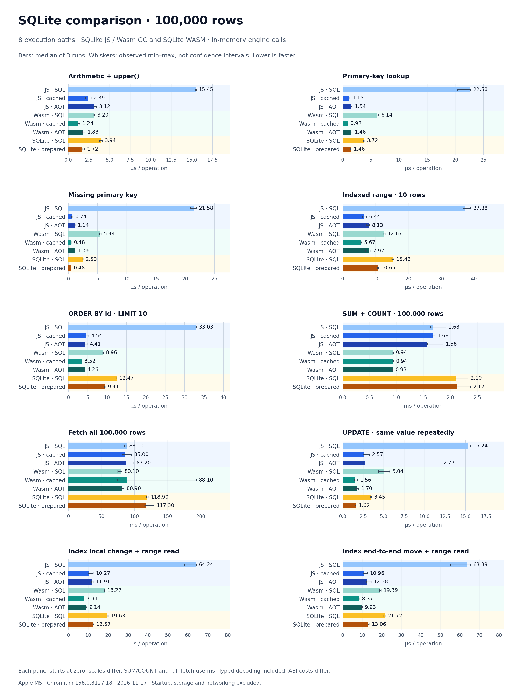

# 10万行のSQLite比較

通常の100 / 1,000 / 5,000行と、10万行の経路を分ける。日常の`sqlite-bench` / `sql-prepare-bench` / P0は従来のデータセットを維持する。

```sh
just sqlite-large-bench
# 任意の行数。100〜100,000の100の倍数を指定できる
just sqlite-bench --prepared --rows=100000 --profiles=false
# 1サンプルの動作確認。通常の計測レポートを上書きしない
just sqlite-bench --smoke --prepared --rows=100000
```

専用タスクはSQLike JS / Wasm GCのAOT・uncached SQL・cached SQLと、SQLite WASMのprepared / prepare毎回の計8経路を同じChromiumページで比較する。全8 workloadと、実変更＋範囲読取の局所変更・索引両端移動を残す。native SQLiteを参照し、実行前後の型付き行・更新結果を照合する。全件読取では10万行全てを照合し、集約でも行数と合計を確認する。

## 実行時間の制御

| 設定 | 通常（10,000行以下） | 大規模（10,000行超） |
| --- | --- | --- |
| サンプル数 | 7 | 3 |
| 1サンプルの目標 | 50 ms | 20 ms |
| 校正 | 2回 | 2回 |
| 最低反復回数 | 5 | 1 |
| 返却行数の反復予算 | なし | 200,000行 / sample |
| warmup | 最大200回 | 最大2回 |
| JSON decode診断 | 最低50回、warmup 100回 | 最大200,000行、warmup 1回 |
| データセットのwatchdog | 180秒 | 120秒 |

行数予算は`expectedRows × iterations`で反復数を制限する。例えば10万行のscanは校正時点で最大2回、1回が20 msを超えればsampleは1回まで下がる。1回のクエリやGCを20 msで中断するものではなく、実際の時間と反復回数を記録する。少ないサンプルの結果なので、小さい差を最適化の効果と判定しない。

10万行だけの指定では、100行＋無関係5,000行の診断を追加しない。CPU profileは既存の1,000行 / 無関係表の診断でのみ採取する。`sqlite-large-bench`はprofileを無効にする。cacheの保持heap診断は計測後にGCして別に記録する。

## 初期データの準備

大規模経路ではnative SQLiteの初期状態を`DatabaseSync.serialize()`で一度取り出し、SQLikeの公開SQLite importで読み込む。その論理画像を各SQL / AOT接続へ公開restore API経由で復元する。AOTはprogram / schema identityの検査を通し、各接続は独立した状態を持つ。SQLite WASMは同じSQL batchで初期化する。

この初期化は計時外であり、INSERTの性能・画像復元の比較・アプリ全体の起動時間は測らない。schema・行データを揃え、対象クエリの結果をnative SQLiteと照合する。画像復元とINSERTでは初期の接続カウンターが異なるため、初期カウンターの同値性はこのbenchmarkの主張に含めない。UPDATEの主表は最初の変更後の同値反復で、実変更は索引の2 workloadに分ける。

レポートには初期SQLite画像のbytes / SHA-256、source / artifact hash、sampling設定、`setupMilliseconds` / `measurementMilliseconds` / `totalMilliseconds`、スクリプトの経過時間を残す。スクリプトの経過時間にはMoonBitのbuild・pnpm起動を含めない。watchdogはbrowser pageを閉じて異常終了する。同期的なnative oracle処理を途中で中断する機構ではない。

## 計測結果

[](../images/sqlite-large-benchmark.png)

[SVG版](../images/sqlite-large-benchmark.svg)

短い棒ほど高速。各パネルの軸はゼロから始まり、処理ごとに尺度が異なる。集約と全件取得はms、ほかはµs。ひげは観測した最小〜最大で、信頼区間ではない。画像をクリックすると原寸のPNGを開ける。

READMEとこのページのプレビューはPNGを使う。SVGは文字をpathへ変換せず、textとして保持する。文字pathの縮尺変換が失われると巨大な文字がグラフを覆う表示を再現できたためで、PNGの明暗テーマ・モバイル幅と、再生成したSVGのブラウザ表示を確認した。SVGの文字は閲覧環境のフォント設定にも依存する。

<!-- sqlite-large-results:start -->
2026-11-17、Apple M5 / Chromium 158.0.8127.18、10万行、3サンプルの中央値。単位µs。

| workload | JS AOT | JS uncached | JS cached | Wasm AOT | Wasm uncached | Wasm cached | SQLite prepared | SQLite uncached |
| --- | ---: | ---: | ---: | ---: | ---: | ---: | ---: | ---: |
| 定数式 | 3.12 | 15.45 | 2.39 | 1.83 | 3.20 | 1.24 | 1.72 | 3.94 |
| 主キーhit | 1.54 | 22.58 | 1.15 | 1.46 | 6.14 | 0.92 | 1.46 | 3.72 |
| 主キーmiss | 1.14 | 21.58 | 0.74 | 1.09 | 5.44 | 0.48 | 0.48 | 2.50 |
| 範囲10行 | 8.13 | 37.38 | 6.44 | 7.97 | 12.67 | 5.67 | 10.65 | 15.43 |
| LIMIT 10 | 4.41 | 33.03 | 4.54 | 4.26 | 8.96 | 3.52 | 9.41 | 12.47 |
| SUM＋COUNT | 1,575.00 | 1,681.82 | 1,683.33 | 931.82 | 938.10 | 936.36 | 2,120.00 | 2,100.00 |
| 全10万行 | 87,200.00 | 88,100.00 | 85,000.00 | 80,900.00 | 80,100.00 | 88,100.00 | 117,300.00 | 118,900.00 |
| 同値UPDATE | 2.77 | 15.24 | 2.57 | 1.70 | 5.04 | 1.56 | 1.62 | 3.45 |

実変更＋範囲読取の1 cycle（µs）:

| workload | JS AOT | JS uncached | JS cached | Wasm AOT | Wasm uncached | Wasm cached | SQLite prepared | SQLite uncached |
| --- | ---: | ---: | ---: | ---: | ---: | ---: | ---: | ---: |
| 索引値の局所変更 | 11.91 | 64.24 | 10.27 | 9.14 | 18.27 | 7.91 | 12.57 | 19.63 |
| 索引の両端へ移動 | 12.38 | 63.39 | 10.96 | 9.93 | 19.39 | 8.37 | 13.06 | 21.72 |

スクリプト全体 **22.57秒**、準備 **7.67秒**、計測・照合 **13.97秒**。残りは起動・cache保持heap診断などを含む。8 workload × 8経路の64組を照合した。全件scanの反復は各sample **1回**、decode診断は **2回**・warmup **1回**だった。
<!-- sqlite-large-results:end -->

[索引・UPDATE・結果ABI・大量書込の試行](optimization-trials.md)を反映した現行値。索引両端移動＋範囲読取はcached SQLでJS 10.96 / Wasm 8.37 µs（SQLite prepared 13.06 µs）となり、初回の198.02 / 38.40 µsから短縮した。異なる日時の段階比較なので、少数サンプルの小差を改善と断定しない。通常の結果JSON ABIは維持し、native結果の実験は別の比較へ分ける。

[raw report](../../measurements/dynamic-prepare-large-current.json)。SQLikeは事前encode済みbindと返り値のJSON.parse、SQLite WASMは型の取得・BigInt化を含む。ABI費用は同一ではない。永続化・ネットワーク・Drizzleを含まないmemory DBの条件であり、通常の[5,000行の比較](dynamic-sql-prepare.md)とは準備方法とサンプル予算が異なる。

出力先の既定は、大規模を含むprepared比較が`measurements/dynamic-prepare-large-current.json`、uncached / AOTの6経路比較が`measurements/sqlite-large-current.json`。小さいデータセットの現行レポートを上書きしない。`--output=...`で変更できる。

スケジューリングは[policy](../../scripts/sqlite-bench-policy.ts)へ分離し、[テスト](../../tests/sqlite-bench-policy.test.ts)で行数の境界・独立した出力先・scan / decodeの反復上限を検査する。この計測用policyはruntimeの配信bundleに含めない。
